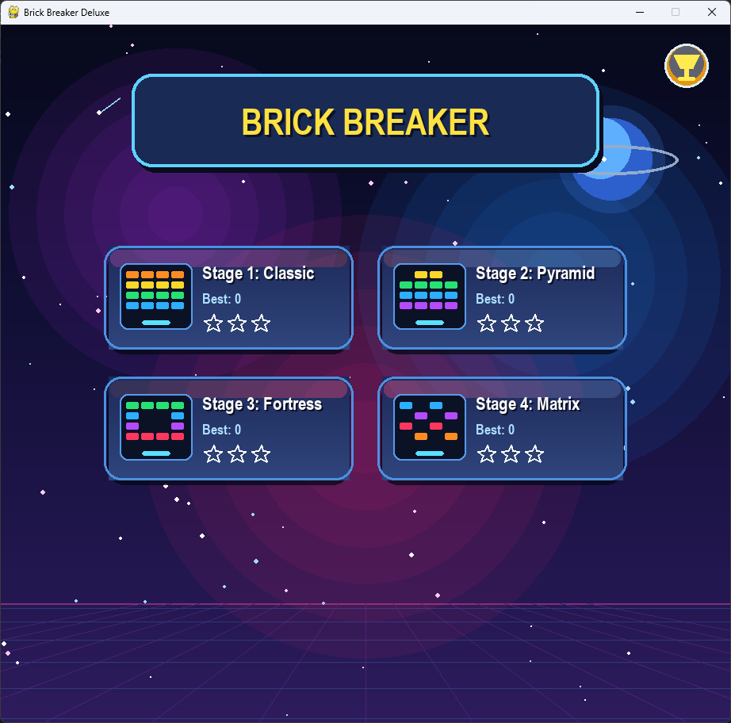
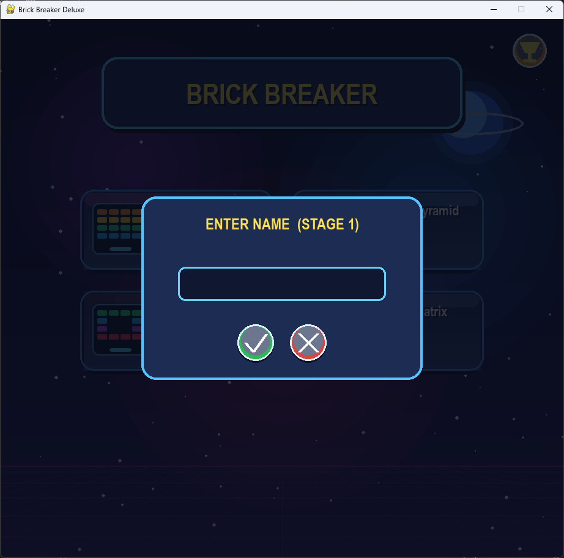
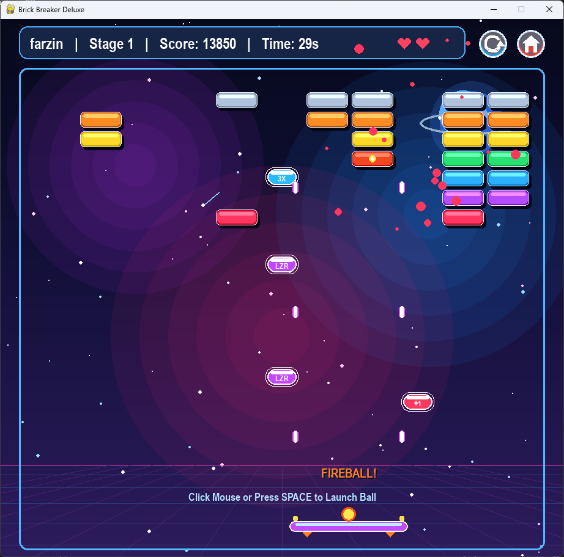
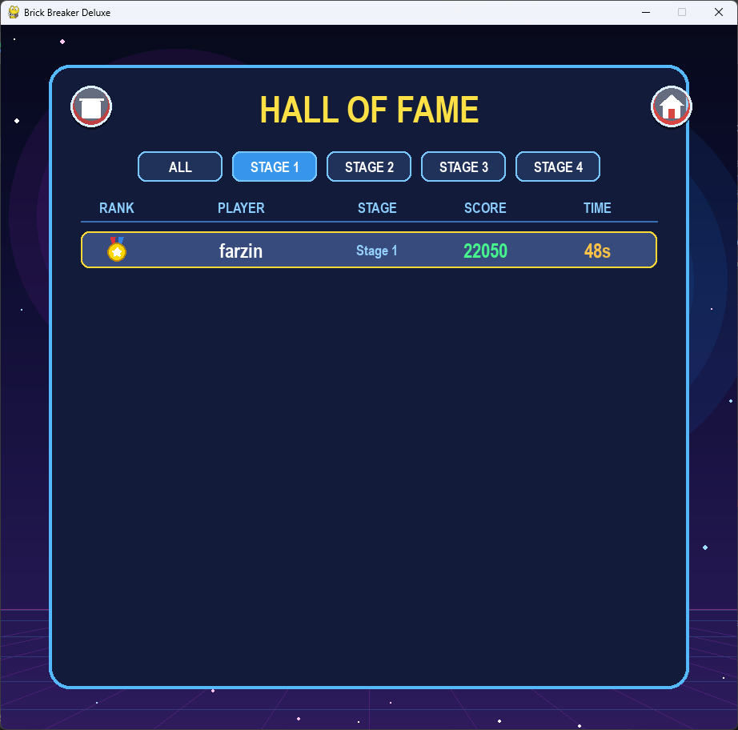

# Brick Breaker Deluxe in Python

## introduction
When we run `Brick Breaker.py` on the computer it opens a 920x880 window using `pygame`. There is no need to use external files. When the window opens the game starts in the state `self.state = "menu"`. We have 4 stage cards for Stage 1 (Classic), Stage 2 (Pyramid), Stage 3 (Fortress) and Stage 4 (Matrix). You can type your name into `self.player_name` up to 14 letters in `self.state = "name_input"`. After clicking `btn_name_ok` the state goes to `self.state = "playing"` with 3 lives (`self.lives = 3`), the paddle, and the `self.bricks` list created by `build_bricks(stg)`.

When you launch the ball in `self.state = "playing"` the code moves it and checks collisions with the paddle and bricks. To win the stage you must break all bricks in `self.bricks` before `self.lives` hits 0 and `save_record()` saves your score in `scores.json`.

## Screenshots

<p align="center">
  
  
</p>
<p align="center">
  
  
</p>

## Features

Here are the main classes and functions in `Brick Breaker.p` that run the space background, bricks, power-ups and scoreboard.

`SAVE_FILE`. `self.records`: This keeps the top 50 scores inside `scores.json`. The `load_records()` function loads the file at start and `save_record()` updates `self.best_scores` and `self.best_stars`.

`draw_scoreboard()`. `draw_medal()`: Clicking `btn_menu_trophy` sets `self.state = "scoreboard"` to show the Hall of Fame. You can filter by `ALL`, `STAGE 1`, `STAGE 2`, `STAGE 3` or `STAGE 4`, and `btn_board_clear` deletes `scores.json`.

Hit brick. Bomb bricks: When a ball hits a brick in `hit_brick()`, it reduces `brick.hp` and adds `50 * min(8, self.combo)` points. If `brick.is_bomb` is True, `explode_bomb()` shakes the screen (`self.shake = 16`), spawns a `Shockwave`, and destroys nearby bricks within `115` pixels.

Multi-ball. Fireball: When a brick breaks there is a `0.24` chance to drop a `PowerUp`. Catching `"multi"` (`3X`) adds 2 extra `Ball` objects to `self.balls`, and catching `"fire"` (`FIRE`) sets `self.fire_until` for 7 seconds so the ball goes right through bricks without bouncing.

Laser. Wide paddle: Catching `"laser"` (`LZR`) sets `self.laser_until` for 8 seconds and shoots two `Laser` beams from the paddle every `280` milliseconds. Catching `"wide"` (`WIDE`) changes `target_w` from `135` to `195` for 10 seconds.

`self.lives`. `draw_heart()`: Catching `"life"` (`+1`) adds 1 heart to `self.lives` up to 5. When you clear all bricks you get `self.lives * 300` bonus points and 1 to 3 stars based on your remaining lives.

## How To Use

When we run this code it starts pygame using `pygame.init()`. It opens a game window with `pygame.display.set_mode((WIDTH, HEIGHT))`. First open your command prompt or terminal. If you do not have pygame installed on your computer you must install it using pip. Then run `"Brick Breaker.py"` in the terminal.

```
pip install pygame

python "Brick Breaker.py"
```

At first the window opens in the state `self.state = "menu"`. You can set your name and start a stage using the mouse or keyboard.

Click on stage card: To pick between Stage 1, Stage 2, Stage 3 and Stage 4 click on one of the 4 cards on the menu screen.

Type. Backspace: In `self.state = "name_input"` just type letters, up to 14 characters. To delete letters press the BACKSPACE key. Press ENTER or click the green check button to start.

Trophy or Trash button: To open `self.state = "scoreboard"` click the yellow trophy button. To clear all saved scores click the red trash button.

In the game screen, where `self.state = "playing"` you control the paddle and break bricks using the mouse and keyboard.

Click or SPACE to launch: At the start of a round the ball is stuck to the paddle (`b.stuck = True`). Click the mouse or press the SPACE key to launch it.

Move paddle: Move your mouse left and right, or press `LEFT` / `RIGHT` arrow keys (or `A` / `D` keys) on the keyboard to move the paddle and catch falling power-ups.

Press R or Reload button: When you want to play again, press the R key. Or click `btn_restart` to reset the stage.

Press M key: To return to `self.state = "menu"` and pick another stage press the M key.